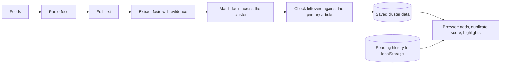

# Design: Comparison pipeline

## Overview

The work splits into two halves.

- **Pipeline** (`src/pipeline/`, server or build time). It reads feeds and gets full text. It extracts facts with evidence sentences and matches facts across a cluster. Then it checks every statement still left out of the primary's facts against the primary article's full text, and saves the result. For the starter pack it runs once ahead of time, and the output is committed. For feeds a user adds, it runs on the server.
- **Comparison** (`src/lib/adds.ts`, browser). It takes the saved facts and the user's reading history and works out each source's "+" lines, duplicate score, and highlights, plus the cluster's read state. It never calls an AI model.



The loader reads the sample feeds with the same parser that reads real feeds. It then attaches the AI pipeline's saved facts from `data/sample/results/`. A story without saved results falls back to its hand-written fact table.

## Data model

Defined in `src/lib/types.ts`.

```ts
type FactId = string;

interface Fact { id: FactId; text: string }                 // the "+" line wording
interface Evidence { factId: FactId; sentence: string }     // verbatim sentence in one article
interface Source { id: string; name: string; feedUrl: string }

interface Article {
  id: string;            // feed entry ID
  sourceId: string;
  title: string;
  url: string;
  author?: string;
  publishedAt: string;   // ISO 8601
  paragraphs: string[];  // plain text
  evidence: Evidence[];  // in reading order
}

interface Cluster {
  id: string;
  title: string;
  primaryArticleId: string;
  articleIds: string[];  // primary first, then by publish time
  facts: Record<FactId, Fact>;
}
```

## The comparison

Let F(a) be the set of fact IDs in article a, P the primary article, and R the set of articles the user has read in the cluster.

- **Seen facts** for a source s: S(s) = F(P) ∪ F(r) for every r in R other than s.
- **Adds:** if s is P or s is in R, adds(s) is empty. Otherwise adds(s) = F(s) \ S(s), in the order the facts appear in s.
- **Duplicate score:** dup(s) = |F(s) ∩ S(s)| / |F(s)|. It is undefined when F(s) is empty, and the panel shows "Limited source content" instead.
- **Highlights:** for s other than P, the evidence sentences for F(s) \ (F(P) ∪ F(r) for every r read before s). The reading history keeps first-read order, so highlights don't change after the fact.
- **Cluster state:** unread if no article in the cluster is in R. Read if P is in R and every unread source has empty adds. Partly read otherwise.
- **Pulling an article out (X):** the article becomes a one-article cluster. If it was the primary, the earliest remaining article becomes the primary.

### Worked example: the fictional Corvid RV-90 launch

Primary article: Byteward (f01 to f05).

| After reading | Launch Desk | FrameTime | Ohm & Bit |
|---|---|---|---|
| Byteward | f06, f07 | f08, f09, f10 | f06, f07, f08, f10, f11, f12, f13 |
| Byteward, FrameTime | f06, f07 | read | f06, f07, f11, f12, f13 |
| Byteward, FrameTime, Ohm & Bit | No significant new information | read | read |

f08 (38% faster at 4K) and f10 (320 W) appear under both FrameTime and Ohm & Bit until the user reads one of them. A rule that only kept facts unique to one source would hide them from both lists.

## Correctness properties

Each property is a fast-check test in `tests/adds.property.test.ts`, run on random clusters and reading histories.

| ID | Property | Requirements |
|---|---|---|
| P1 | A source's adds are a subset of its facts. | 4.2 |
| P2 | Adds never include a fact from the primary article or a read article. | 4.3 |
| P3 | Reading more never makes a list longer. | 4.3 |
| P4 | The primary article and read articles add nothing. | 4.1, 4.2 |
| P5 | Lists depend on which articles were read, not the order. | 4.3 |
| P6 | For an unread source with facts, the adds and the seen facts together cover all of its facts, so dup(s) = 1 − adds/facts. | 5.2 |
| P7 | A fact the user hasn't seen appears under every unread source that reports it. | 4.5 |
| P8 | A cluster is read exactly when its primary is read and no unread source adds anything. | 7.1, 7.2, 7.3 |

## Feeds

`parseFeed(xml)` in `src/pipeline/feeds.ts` reads Atom and RSS 2.0. For content it prefers `content:encoded`, then `content`, then `description`, then `summary`. It converts HTML to plain-text paragraphs.

## Error handling

- An evidence sentence that isn't verbatim in its article is dropped (Requirement 1.2). In the sample data, the loader throws instead, so a broken fact table fails the build.
- An article without facts shows "Limited source content" (Requirement 1.3).
- An AI failure shows "Comparison unavailable" (Requirement 11.2).
- If localStorage is missing or holds bad data, the reader starts with an empty history.

## Testing strategy

- Unit tests for the RV-90 example above (`tests/adds.test.ts`).
- Property tests P1 to P8 (`tests/adds.property.test.ts`).
- Sample data checks: the feeds parse, and every evidence sentence appears verbatim in its article (`tests/sample-data.test.ts`).
- The accuracy check compares pipeline output with the fact tables and fails under 8 of 10 (task 4.5, issue #14).
